# Journal Abstract Workflow

Collect journal metadata and available abstracts with a repeatable Python workflow.
Start with Crossref's journal records, fill gaps by DOI through OpenAlex and Semantic
Scholar, keep the source responses, and inspect questionable text before using it.

The focus is management research in the **UTD24 and FT50** journal lists. The underlying
workflow has been used on **21 journals**; 19 belong to the current list union.
The registry also identifies journals whose full pipeline has not been demonstrated.
See [journal coverage](docs/JOURNALS.md) and [the evidence and its limits](docs/EVIDENCE.md).
List membership, successful downloading, and abstract quality are separate claims.

**Public code and methods release.** Includes synthetic examples and independently
reviewed tools. It does not distribute the earlier abstract collection or its
private history.

## Try it offline

Requires **Python 3.10 or newer**. There are no third-party Python dependencies and
no AI subscription is needed to run the tools. Download the repository and open a
terminal in its folder.

```sh
python3 scripts/demo.py --output runs/demo
python3 scripts/audit_outputs.py runs/demo
python3 -m unittest discover -s tests -v
```

The demo uses invented papers and texts. It exercises Crossref parsing, gap filling,
review decisions, duplicate handling, optional reference tables, and offline replay
without contacting a service. The tables are ordinary CSV files, readable in Python,
R, or spreadsheet software.

## Collect a journal

First inspect the registry, then select a journal by its slug (the short name in the
first column). These examples use Organization Science.

```sh
python3 scripts/pipeline.py --list
python3 scripts/pipeline.py --output runs/my-corpus organization-science
python3 scripts/audit_outputs.py runs/my-corpus
```

This requests the journal's available DOI records across its configured ISSNs; a
large journal can require thousands of supplementary lookups. You must select
journals or a profile explicitly. To collect several, list their slugs in the same command:

```sh
python3 scripts/pipeline.py --output runs/my-corpus organization-science strategic-management-journal
```

Optional credentials are `OPENALEX_API_KEY`, `SEMANTIC_SCHOLAR_API_KEY`, and
`CROSSREF_MAILTO`. Set these in your environment if you use them. The scripts do not
load `.env` files automatically. Consult [sources and service access](docs/SOURCES.md)
for the current provider instructions. API access and quotas vary; the tools do not
promise unlimited or complete retrieval.

If a request fails, rerun the same command to reuse completed source downloads.
The runner restores the previous completed tables and manifest after a failed
attempt, retaining the attempt and prior snapshot under `.history/`. To rebuild
from saved responses without network access:

```sh
python3 scripts/pipeline.py --output runs/my-corpus --offline organization-science
```

A failed Crossref ISSN download restarts that ISSN in a separate snapshot; completed
ISSNs are reused. OpenAlex saves progress every 25 lookups and on normal interruption,
so an abrupt process kill may repeat a few requests. Semantic Scholar checkpoints
each successful batch. Provider error objects and malformed saved responses are
retryable failures, not evidence that an article has no abstract. Repairs retain
the original cache bytes. Earlier attempt files remain available for inspection.

To include a reference table, add `--references` to either command. Crossref reference
lists are preferred, with OpenAlex work IDs used where Crossref has no list.
Once a reference table exists, later runs rebuild it even without that switch,
so changed duplicate decisions are reflected. Reference coverage is distinct
from abstract coverage.

Use a **new output directory for a new dated snapshot**. Reusing a directory reuses
saved responses; it is not a refresh of the latest API state. Keep one pipeline
process per output directory and avoid concurrent processes against the same API
account: request pacing is per process.

## What happens

```mermaid
flowchart LR
    A[Choose journal and ISSNs] --> B[Crossref records]
    B --> C[Merge by DOI and tag item kinds]
    C --> D[OpenAlex lookup by DOI]
    D --> E[Semantic Scholar for remaining gaps]
    E --> F[Screen candidate texts]
    F --> G[CSV plus source and gap records]
    G --> H[Read flagged texts and record decisions]
    H --> I[Replay from saved sources]
```



1. Query every configured ISSN, including documented predecessor identifiers. Merge
   identical DOIs and omit journal/issue container records.
2. Preserve deposited Crossref text. Treat empty fields and short texts under 30
   words as possible gaps, keeping the original short text if no qualifying
   replacement is found.
3. Look up each DOI in OpenAlex, reconstruct its abstract from word positions, then
   query Semantic Scholar for remaining gaps.
4. Flag suspect candidate text: wrong DOI, title-only text, body-style citations,
   opening headings, or unusual length. A flag is a prompt to read the text.
5. Keep explicit decisions for duplicates, item kinds, rejected texts and accepted
   flagged texts. Rebuild derived files from the saved responses and those decisions.

Automated screening can miss contamination and can flag real abstracts. Read the
[practical review guide](docs/REVIEW.md), especially for older literature. No LLM is
used to invent or reconstruct a missing abstract.

## Outputs

All paths below are inside the output directory you choose.

| File | Meaning |
|---|---|
| `data/<journal>/records.csv` | DOI, title, publication metadata, item-kind guess, abstract, source, word count and duplicate markers |
| `data/<journal>/abstract_gaps.csv` | Gap outcomes, short-text originals, screening flags and review notes |
| `data/<journal>/openalex.csv` | Supplementary OpenAlex metadata |
| `data/<journal>/review.json` | Optional explicit decisions that you author; see [example](examples/review.json) |
| `data/<journal>/summary.json` | Stage counts and file hashes; stage meanings differ |
| `data/<journal>/references.csv.gz` | Optional reference rows; not a complete or deduplicated citation graph |
| `raw/` | Saved provider responses for offline rebuilding |
| `data/journals_crossref.csv.gz` | Combined final rows from journals in the output directory |
| `run_manifest.json` | Requested and combined journal sets, registry, review, tool, input and output hashes |
| `run_state.json` and `.history/` | Run status and retained recovery snapshots |

The combined table includes previously collected journals in that output directory;
the manifest records all of them. Keep their registry entries when using a custom
registry, or choose a separate output directory. The runner stops if an existing
journal would be silently omitted.

`kind_guess` is a title-based heuristic, not a publisher classification. A nonempty
abstract field may still be incomplete or wrong. A missing field may reflect a
source gap. Counts of text at least 30 words are a diagnostic, not a quality score.
Use the audit's final-table counts instead of adding counts from different pipeline
stages. See [the tool inventory](docs/TOOLS.md) for each script's role.

## Choose or extend the journal set

[config/journals.json](config/journals.json) stores titles, ISSNs, dated list
memberships and evidence status. Historical FT50 membership is kept separately from
the 2026 list. Strategy Science is an optional demonstration outside either list;
Organization Studies is a historical FT50 example.

Supply a registry with the same schema using `--registry path/to/journals.json`.
Verify new ISSNs against publisher and Crossref records, include relevant former
titles, then run one journal and inspect its outputs. Adding a registry entry alone
does not establish collection coverage or abstract accuracy. The repository includes
no claim that every UTD24/FT50 journal deposits all its articles or abstracts.

For a larger collection, `--all` selects the 19 demonstrated current-list defaults.
`--profile utd24`, `--profile ft50-2016`, or `--profile ft50-2026` selects that list,
including journals without a demonstrated full run. Profiles report unsupported
entries as skipped; Harvard Business Review's Crossref route is currently
unsupported. These commands can take substantial time and API budget. Start with
one journal to understand the output before choosing a whole profile.

## Reuse and attribution

Code and documentation are [MIT licensed](LICENSE). Retrieved abstracts retain their
applicable publisher or author rights; this code license does not authorize their
redistribution. Credit Crossref, OpenAlex, Semantic Scholar and the original article
authors when building on their records. Full provider links and method references
are in [sources and credits](docs/SOURCES.md).

Files and commit authors are anonymized; the GitHub owner remains visible.
See [privacy boundaries](docs/PRIVACY.md) and [release status](docs/RELEASE.md).
The [independent review](docs/INDEPENDENT_REVIEW.md) records tested failures, fixes,
and the full saved-response replay.
